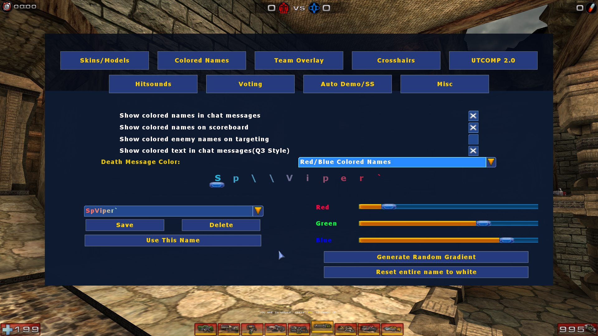
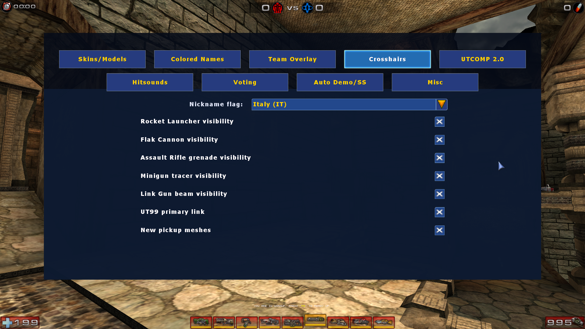
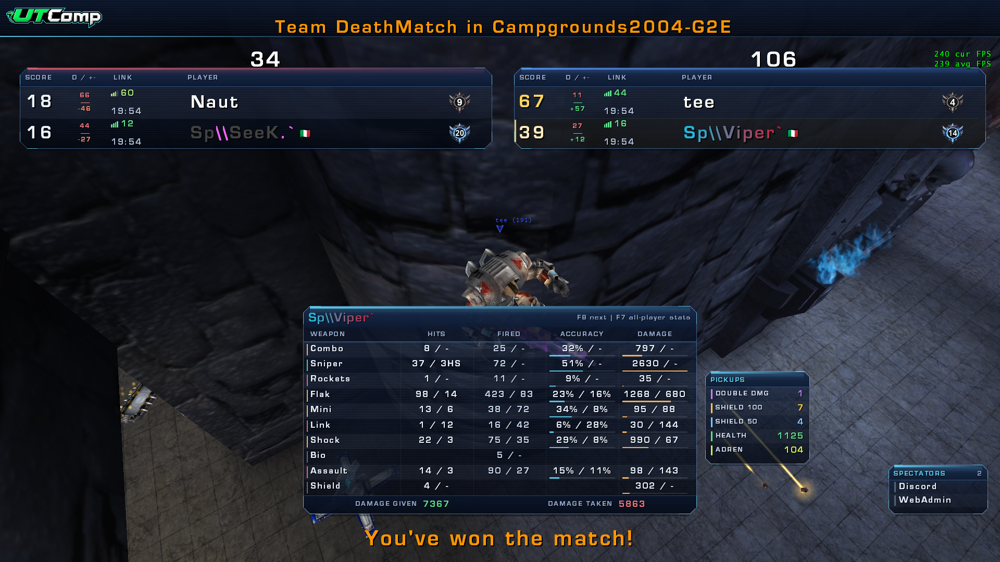
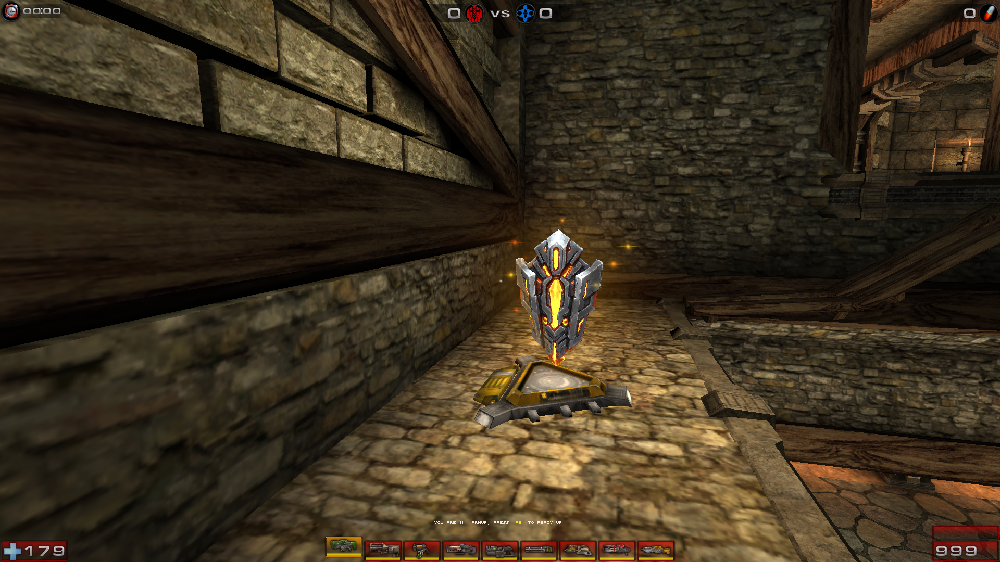
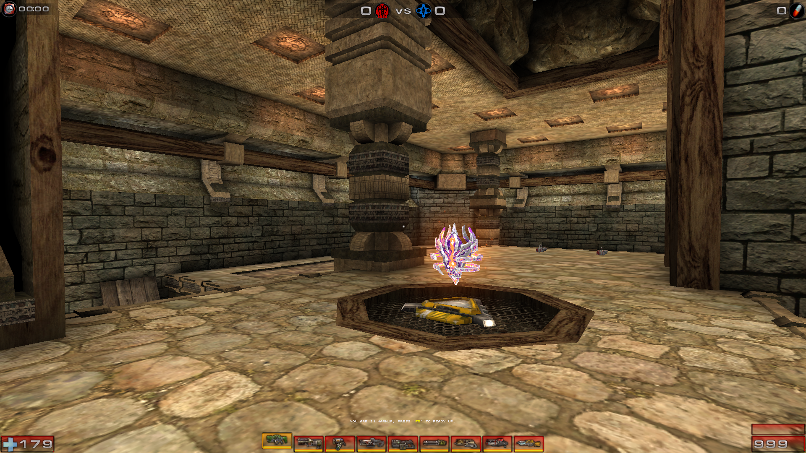
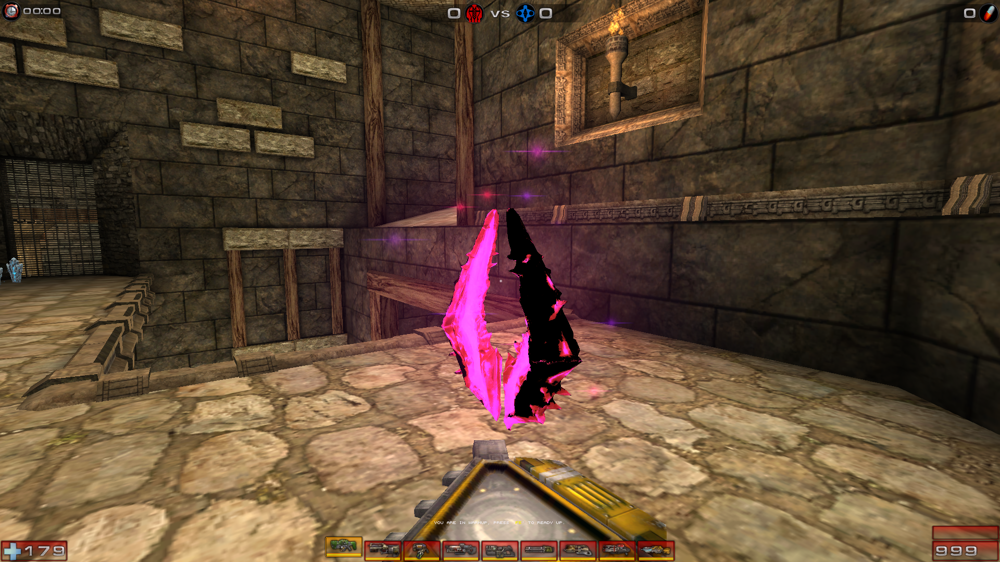

# UTComp v20 server package

This repository contains the files needed to install UTComp v20 on an Unreal
Tournament 2004 dedicated server. The UnrealScript source and build tooling are
maintained separately in [viperozza/utcomp2_0](https://github.com/viperozza/utcomp2_0).

## Contents

```text
System/
  UTCompv20.u
  UTCompv20.ucl
examples/
  UT2004.ini.example
  UTCompv20.ini.example
SERVER_INSTALL.md
```

Start with [SERVER_INSTALL.md](SERVER_INSTALL.md). The files under `examples/`
are templates: review them before applying them to a live server, and never
replace a server's complete `UT2004.ini` with the short example fragment.

## What changed from UTComp 1.8b-K4

UTComp v20 keeps the familiar UTComp match flow and client experience while
reworking network validation, configuration, presentation, and diagnostics.

- **Standalone package:** the K4 base classes and required assets are compiled
  into one `UTCompv20.u`, with no separate UTComp or `minimegatex` runtime
  dependency.
- **Stricter enhanced netcode:** supported hitscan weapons use one capped,
  server-authoritative rewind snapshot. Client-reported hits and misses cannot
  broaden the server's validation sweep.
- **Mover-aware rewind:** player and mover history are evaluated in the same
  historical frame, addressing false hits through lifts and shots blocked by a
  lift's newer position.
- **Consistent Shock Cores:** primary fire traces the real authoritative core
  without double-rewinding it or trusting a client-only fake core. Strict
  alt-fire also validates a latency-adjusted origin and aim.
- **Shield Gun protection:** shield drain and reflection remain server-side,
  with a bounded shield-up grace window and configurable arc tolerance for
  high-ping desynchronization.
- **Per-weapon controls:** enhanced netcode can be selected independently for
  supported weapons, including Flak Cannon, Rocket Launcher, and Bio Rifle.
- **Client-side weapon effects:** independent options on the `UTCOMP 2.0` menu
  control each effect locally. They do not alter collision, speed, damage,
  physics, weapon timing, or server authority.
  - Normal and seeking **rockets** retain the stock mesh, corona, and smoke,
    while adding a wider light radius and a short orange exhaust flame with a
    soft afterglow that follows the rear nozzle.
  - **Flak primary shards** use a larger rendered mesh and a stronger, longer
    additive trail. **Flak secondary shells** add a bright yellow unlit glow
    and a small dynamic light so they remain readable at reduced detail.
  - **Assault Rifle grenades** add a thin bright-orange additive streak over
    the stock smoke trail; the streak stops regenerating when the grenade
    settles or is destroyed.
  - **Minigun primary fire** uses sampled light-blue tracers, while secondary
    fire uses red tracers. The attachment switches emitter and cadence with
    the active fire mode while the weapon itself remains hitscan.
  - The **Link Gun secondary beam** gains a clean green core, surrounding
    electric strands, dynamic light, and an additive glow. Sustained damaging
    contact gradually increases its width and brightness and introduces a
    restrained pulse, then the charge decays when contact ends.
  - The optional UT99-style **Link Gun primary projectile** replaces the stock
    trail with a compact green energy sphere, flickering corona, short
    electrical arcs, dynamic light, and axial spin that slows with distance.
- **Optional pickup meshes:** a client-side `New pickup meshes` switch replaces
  the stock Adrenaline, Health Vial, Health Pack, Shield 50, Shield 100, and
  Double Damage presentations with new packaged meshes and skins. Their
  tailored halos, motes, sparks, and colored dynamic lights improve pickup
  recognition; opting out restores the stock appearance for that client.
- **Modern HUD and scoreboard:** redesigned panels add clearer player rows,
  ping-quality indicators, readiness state, frag differential, country flags,
  pickup summaries, spectator information, and consistent spectating views.
- **Expanded statistics:** `F7` opens an all-player weapon comparison with
  accuracy, damage, best/worst highlighting, and a total-damage leader marker.
- **Server analysis tools:** optional combat diagnostics explain Shock,
  Lightning Gun, and Shield decisions, while match heatmaps record movement,
  kills, deaths, pickups, timelines, and player filters.
- **Richer colored names:** the editor supports the complete RGB range and can
  generate dark, muted, pastel, or vivid gradients.

## Screenshots

### Colored-name editor



### UTComp 2.0 settings



### Scoreboard and weapon statistics



### Optional pickup meshes

Shield 50:



Shield 100:



Double Damage:



## License

UTComp v20 is distributed under the GNU General Public License v3.0. See
[LICENSE](LICENSE).
